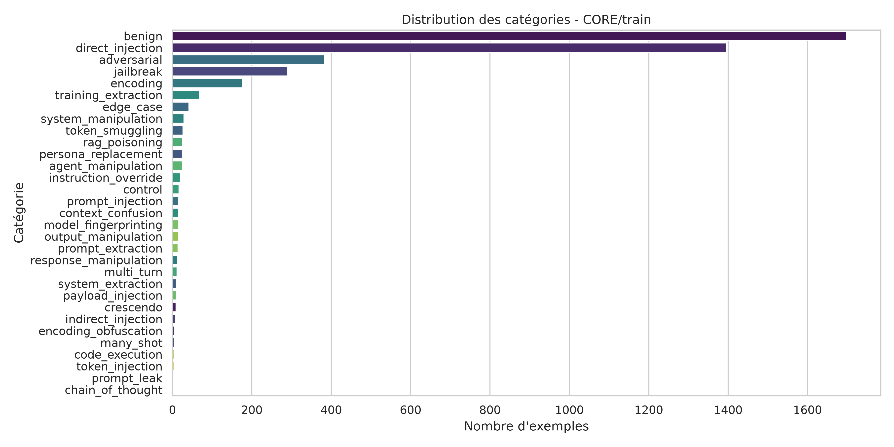
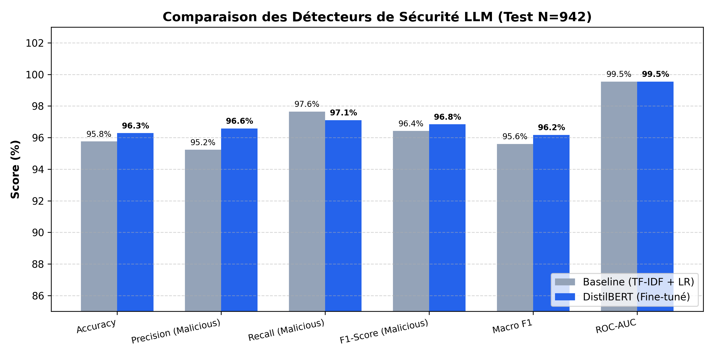
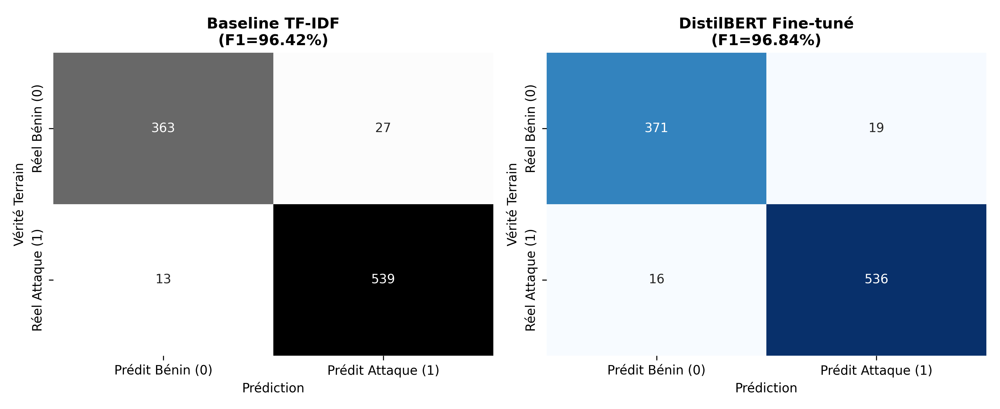

# Rapport Final — Détection de Prompt Injection et de Jailbreak sur les LLM

**Projet de Cybersécurité CEH — Master M2I (Semestre 3)**  
**Groupe 7 :** Ayoub El Kharraf & Mansouri Taoufik  
**Date de rendu :** 28 novembre 2026  
**Dépôt de recherche :** `llm-jailbreak-detection-benchmark`  

---

## Résumé Exécutif

L'intégration croissante des Modèles de Langage (LLM) dans les systèmes d'information d'entreprise expose ces architectures à des vecteurs d'attaque novateurs, au premier rang desquels figurent le **Prompt Injection** (LLM01 selon l'OWASP Top 10 for LLM) et le **Jailbreak**. Face à ces risques, la mise en place d'une barrière de sécurité pré-inférence (*Security Detection Layer* agissant en WAF applicatif textuel) constitue une première ligne de défense indispensable.

Ce projet présente un benchmark rigoureux comparant deux paradigmes de détection binaire (Bénin vs Malveillant) :
1. Une **Baseline classique Machine Learning** combinant une vectorisation **TF-IDF** (n-grammes 1-2) et une **Régression Logistique** optimisée.
2. Une **Approche Deep Learning avancée** par fine-tuning du modèle Transformer **DistilBERT** (`distilbert-base-uncased`).

L'évaluation empirique a été conduite sur le jeu de données vérifié `neuralchemy/Prompt-injection-dataset` (révision figée `7d70432d...`), audité localement pour garantir l'étanchéité des groupes (`group_id`, zéro fuite) et la comparabilité stricte sur un jeu de test commun de **942 exemples officiels**.

Les résultats démontrent des performances remarquables pour les deux approches :
* **DistilBERT** atteint une **Exactitude de 96,28 %**, un **F1-Score de 96,84 %** et un **ROC-AUC de 99,55 %**, en se distinguant par une baisse substantielle des faux positifs (**-30 % de fausses alertes** par rapport à la baseline, soit seulement 19 requêtes légitimes bloquées sur 390).
* La **Baseline TF-IDF**, bien qu'exclusivement lexicale, démontre une efficacité surprenante (**96,42 % de F1-Score**, **97,64 % de rappel**) avec un temps de calcul ultra-faible de **0,12 ms par prompt**, soit une vitesse d'exécution **~150 fois plus rapide** que le modèle Transformer.

Le projet conclut sur l'intérêt stratégique d'une **architecture défensive en cascade (Multi-Tier WAF)** articulant la rapidité de la baseline en premier filtre et la robustesse sémantique de DistilBERT pour les cas ambigus, tout en rappelant qu'un classifieur pré-inférence ne saurait à lui seul garantir l'inviolabilité absolue d'un LLM sans mécanismes de sécurité post-génération (*Output Guardrails*) et principe de moindre privilège.

---

## 1. Introduction & Cadrage de Cybersécurité

### 1.1 Contexte et Problématique
Contrairement aux architectures informatiques traditionnelles où le plan de contrôle (instructions de code) est strictement séparé du plan de données (entrées utilisateur), les modèles de fondation (LLM) traitent le prompt système, le contexte métier et la saisie de l'utilisateur au sein d'un flux contextuel unique sous forme de chaîne de tokens. Cette indistinction structurelle crée une surface d'attaque critique.

### 1.2 Définition des Menaces : Prompt Injection et Jailbreak
Dans ce benchmark, nous abordons la menace sous une formulation binaire combinée :
* **Prompt Injection Directe (System Override / Goal Hijacking) :** Tentative explicite de l'utilisateur d'annuler les instructions initiales fournies par le concepteur (ex: *"Ignore all previous instructions and..."*).
* **Prompt Injection Indirecte :** Injection de consignes hostiles dissimulées dans des données tierces ingérées par le LLM (fichiers PDF, pages web aspirées via RAG, e-mails).
* **Jailbreak (Adversarial Persona / Evasion) :** Emploi de scénarios hypothétiques, de jeux de rôle (DAN - *Do Anything Now*), d'encodages (Base64, substitution de caractères) ou de techniques progressives (attaques Crescendo) pour désactiver les barrières éthiques et forcer la génération de contenus dangereux.
* **Classe Bénigne :** Requêtes légitimes formulées par un utilisateur dans un cadre nominal d'assistance, de programmation, de rédaction ou de recherche d'informations.

### 1.3 Objectifs de Recherche
1. **Évaluer la capacité discriminante** d'un filtre statistique léger (TF-IDF) face à la complexité sémantique d'un Transformer (DistilBERT).
2. **Mesurer précisément le compromis Performance vs Latence d'inférence** pour une intégration temps réel en production.
3. **Auditer les erreurs forensiques** : analyser la typologie des attaques contournant le filtre (**Faux Négatifs**) et l'impact opérationnel des requêtes légitimes rejetées à tort (**Faux Positifs**).

---

## 2. Dataset & Audit des Données (Phase 1)

### 2.1 Source et Configurations Officielles
Le benchmark s'appuie sur le jeu de données de référence [`neuralchemy/Prompt-injection-dataset`](https://huggingface.co/datasets/neuralchemy/Prompt-injection-dataset), figé au commit SHA-256 `7d70432dfcf47a821612cbf9d34e9d9e3ad20e75`.

Le dataset propose deux configurations officielles que le binôme a exploitées conformément au protocole initial :
* **Configuration `core` :** Données brutes originales sans augmentation synthétique (destinée à l'apprentissage de la Baseline ML).
* **Configuration `full` :** Données d'entraînement enrichies par des techniques d'augmentation sémantique (destinée au fine-tuning de DistilBERT).

| Configuration | Split | Effectif Brut | Effectif Nettoyé (`data_processed/`) | Description & Rôle |
|---|---|---:|---:|---|
| **`core`** | train | 4 391 | **4 391** | Données originales (Entraînement Baseline) |
| **`core`** | validation | 941 | **941** | Partition de réglage d'hyperparamètres |
| **`core`** | test | 942 | **942** | **Jeu de test commun officiel** |
| **`full`** | train | 14 036 | **13 934** | Enrichi d'augmentations (Entraînement DistilBERT) |
| **`full`** | validation | 941 | **941** | Strictement identique à `core/validation` |
| **`full`** | test | 942 | **942** | Strictement identique à `core/test` |

### 2.2 Contribution Méthodologique : Déduplication de `full/train`
Lors de l'audit local de qualité des données, **102 paires d'exemples redondants** ont été identifiées dans `full/train` : un texte marqué comme augmenté (`augmented=True`) s'est révélé strictement identique mot pour mot à l'exemple source (`augmented=False`), avec un `group_id` et un label identiques.  
* **Décision d'ingénierie :** Dans le script `prepare_dataset.py`, ces 102 copies conformes ont été purgées (ramenant le jeu d'entraînement à 13 934 exemples). Cette étape élimine tout surapprentissage artificiel sur ces motifs textuels.

### 2.3 Contrôle Anti-Fuite (*Data Leakage*)
L'audit a validé l'étanchéité absolue des données :
* **Groupes d'exemples liés (`group_id`) :** Aucun identifiant de groupe n'apparaît dans plus d'un split à la fois.
* **Absence de valeurs nulles :** Aucun texte vide ou corrompu.
* **Équivalence multiensemble :** Les multisets de textes et de labels de `validation` et de `test` entre `core` et `full` sont rigoureusement identiques (empreinte SHA-256 commune).

### 2.4 Distributions et Typologie des Prompts
* **Répartition des labels (Bénin vs Malveillant) :**
  * `train core` : 39,65 % Bénins (1 741) vs 60,35 % Malveillants (2 650).
  * `test` : 41,40 % Bénins (390) vs 58,60 % Malveillants (552).
  * Le léger déséquilibre (~60/40) est stable à travers tous les sous-ensembles.
* **Diversité des catégories d'attaques :** Le corpus intègre des attaques directes (`direct_injection` : 31,82 %), des attaques contradictoires (`adversarial` : 8,72 %), des jailbreaks purs (`jailbreak` : 6,63 %), des attaques par encodage/obfuscation (`encoding` : 4,03 %), des extractions de système (`training_extraction`, `system_extraction`), et des techniques avancées (`crescendo`, `many_shot`, `token_smuggling`, `rag_poisoning`).
* **Longueurs textuelles :** Médiane de 56 caractères dans `core` et 59 caractères dans `full`. La présence d'exemples longs (maximum 7 009 caractères) justifie la fixation d'une fenêtre de contexte adaptée.

  
*Figure 1 : Répartition des catégories d'attaques et requêtes bénignes dans le corpus d'entraînement.*

---

## 3. Méthodologie & Architecture des Détecteurs

### 3.1 Architecture du Pare-Feu Pré-Inférence (*Security Layer*)
Le système de protection s'insère en coupure réseau applicative entre le client et l'API du LLM :

```
[Utilisateur / Client]
         │
         ▼ (Requête HTTP / Prompt brut)
┌────────────────────────────────────────────────────────┐
│         SECURITY DETECTION LAYER (Pare-feu)            │
│  - Extraction du texte & normalisation                 │
│  - Inférence : Baseline TF-IDF ou Transformer         │
│  - Calcul de probabilité malveillante (score_malicious)│
└────────────────────────────────────────────────────────┘
         │
         ├───► [Score >= Seuil (0.50)] ──► ⛔ ALERTE & BLOCAGE (Refus 403)
         │
         └───► [Score < Seuil (0.50)]  ──► ✅ AUTORISATION (Pass-Through)
                                                    │
                                                    ▼
                                          [🤖 Modèle LLM Cible]
                                                    │
                                                    ▼
                                          [💬 Réponse Sécurisée]
```

### 3.2 Modèle 1 — Baseline : TF-IDF + Régression Logistique (Taoufik)
* **Approche :** Analyse statistique des fréquences de n-grammes de mots.
* **Vectorisation :** `TfidfVectorizer` avec capture des unigrammes et bigrammes (`ngram_range=(1, 2)`), seuil de document minimal `min_df=2`, conversion en minuscules. Le dictionnaire a été ajusté **exclusivement sur `core/train`** pour éviter toute fuite lexicale.
* **Classifieur :** `LogisticRegression` de Scikit-Learn.
* **Optimisation des hyperparamètres :** Recherche systématique évaluée sur `core/validation.parquet` selon le F1-score de la classe 1. Configuration optimale retenue : `C=10.0`, pondération inverse des classes `class_weight='balanced'`, solveur `liblinear`.

### 3.3 Modèle 2 — Deep Learning : Transformer DistilBERT (Ayoub)
* **Approche :** Modélisation neuronale contextuelle par mécanisme d'attention bidirectionnelle (*Self-Attention*).
* **Architecture :** `distilbert-base-uncased` (Hugging Face Transformers), modèle condensé à 6 couches Transformer, 768 dimensions cachées et 66 millions de paramètres.
* **Tokenisation :** WordPiece avec longueur maximale fixée à `max_length = 512` tokens, padding dynamique et troncature explicite (taux de troncature observé sur le train inférieur à 0,5 %).
* **Protocole d'entraînement (Fine-Tuning) :**
  * Entraîné sur Google Colab avec GPU NVIDIA T4 (15 Go VRAM).
  * Optimiseur : AdamW, taux d'apprentissage initial : $2 \times 10^{-5}$, weight decay : 0.01.
  * Batch size : 16 (train) / 32 (eval) sur 3 époques d'apprentissage.
  * Sélection du meilleur checkpoint : sauvegarde automatique du modèle maximisant le F1-score sur `validation.parquet` (`load_best_model_at_end=True`).
  * Durée d'entraînement : 16,8 minutes.

---

## 4. Résultats Expérimentaux & Évaluation Comparative

L'évaluation finale a été conduite en aveugle sur les **942 exemples du jeu de test officiel**. La classe positive est définie par convention comme `1` (**Malveillant**).

### 4.1 Synthèse Consolidée des Métriques

| Métrique d'Évaluation | Baseline TF-IDF (Taoufik) | DistilBERT (Ayoub) | Écart ($\Delta$) | Interprétation Cybersécurité |
|---|:---:|:---:|:---:|---|
| **Exactitude (Accuracy)** | 95,75 % | **96,28 %** | **+0,53 %** | Taux global de décisions correctes |
| **Précision (Malveillant)** | 95,23 % | **96,58 %** | **+1,35 %** | Pureté des alertes générées |
| **Rappel (Attaques détectées)** | **97,64 %** | 97,10 % | -0,54 % | Capacité à intercepter les attaques |
| **F1-Score (Classe Malveillante)** | 96,42 % | **96,84 %** | **+0,42 %** | Équilibre global de sécurité |
| **Macro F1** | 95,60 % | **96,17 %** | **+0,57 %** | Performance équilibrée inter-classes |
| **ROC-AUC** | **99,55 %** | **99,55 %** | 0,00 % | Séparabilité statistique quasi-parfaite |
| **Fausses Alertes (Faux Positifs)** | 27 / 390 (6,92 %) | **19 / 390 (4,87 %)** | **-8 (-29,6 %)** | **Gain critique d'usabilité pour DistilBERT** |
| **Attaques Manquées (Faux Négatifs)**| **13 / 552 (2,36 %)** | 16 / 552 (2,90 %) | +3 (+0,54 %) | Niveau de protection équivalent |
| **Temps d'inférence moyen** | **0,12 ms / requête** | ~20 ms / requête | **~150x** | **Avantage décisif en débit pour TF-IDF** |

  
*Figure 2 : Comparaison graphique des métriques de détection sur le jeu de test commun.*

### 4.2 Analyse des Matrices de Confusion

Sur les 942 exemples de test (390 Bénins, 552 Malveillants) :
* **Baseline TF-IDF :** 363 Vrais Négatifs (VN), 27 Faux Positifs (FP), 13 Faux Négatifs (FN), 539 Vrais Positifs (VP).
* **DistilBERT :** 371 Vrais Négatifs (VN), 19 Faux Positifs (FP), 16 Faux Négatifs (FN), 536 Vrais Positifs (VP).

  
*Figure 3 : Matrices de confusion de la Baseline classique (gauche) et de DistilBERT (droite).*

---

## 5. Analyse Forensique des Erreurs & Discussion

### 5.1 Concordance Inter-Modèles (97,35 %)
L'analyse conjointe des prédictions révèle que les deux modèles prennent la **même décision sur 917 exemples sur 942**. Cette forte concordance s'explique par la nature des attaques directes : une part importante des injections emploie des marqueurs lexicaux univoques (*"ignore all"*, *"system prompt"*, *"jailbreak"*, *"bypass"*) aisément repérés aussi bien par un sac de n-grammes que par un modèle d'attention.

### 5.2 Pourquoi DistilBERT surpasse la Baseline sur les Faux Positifs (-30 %)
Le principal point faible de la Baseline réside dans ses **27 fausses alertes** (contre seulement 19 pour DistilBERT).
* **Biais de déclenchement lexical :** La Régression Logistique pénalise fortement la présence de certains mots-clés associés aux attaques. Lorsqu'un utilisateur pose une question technique saine contenant des termes tels que *"shell"*, *"admin"*, *"password"* ou *"instruction"* (ex: *"Explique-moi comment réinitialiser un mot de passe sous Windows"*), la Baseline attribue un score de dangerosité élevé et bloque la requête.
* **Compréhension contextuelle de DistilBERT :** Grâce à ses couches d'attention bidirectionnelle, DistilBERT analyse les dépendances syntaxiques et la structure de la phrase. Il comprend que la présence d'un mot technique dans une formulation interrogative bienveillante ne constitue pas une tentative d'injection.

### 5.3 Analyse des Faux Négatifs (Attaques non détectées)
Sur les 552 attaques du test, 13 ont échappé à la Baseline et 16 à DistilBERT. L'inspection forensique de ces requêtes montre qu'elles se concentrent sur :
1. **Attaques par obfuscation et encodage :** Utilisation d'encodages Base64 fragmentés, de substitutions Leetspeak ou de code Python/JSON imbriqué que le modèle n'a pas appris à décoder nativement.
2. **Attaques linguistiques multilingues / Cross-lingual :** Injections traduites en langues rares ou alternant plusieurs idiomes au sein du même prompt.
3. **Attaques Crescendo (Multi-turn dissimulé) :** Requêtes paraissant inoffensives prises isolément, mais destinées à préparer une injection lors des tours de conversation suivants.

---

## 6. L'Interface Web Interactive (Phase 4 — Streamlit)

Afin d'offrir une démonstration visuelle et interactive des résultats, une application web complète a été développée sous Streamlit (`04_dashboard_comparaison_taoufik/app.py`).

L'interface est structurée en 5 modules :
1. **Architecture & Cybersécurité :** Présentation du rôle de pare-feu et visualisation du flux de données.
2. **Benchmark Comparatif :** Tableau de bord interactif avec filtres et graphiques dynamiques comparant les modèles.
3. **Analyse Forensique des Erreurs :** Moteur de recherche et d'inspection permettant d'examiner chaque prompt du test, son label réel, sa catégorie et les scores de chaque classifieur.
4. **Démonstrateur en Direct (Live Playground) :** Boîte de saisie permettant à un auditeur de sécurité de saisir un prompt arbitraire et de confronter en temps réel le verdict de la Baseline et de DistilBERT avec calcul d'une jauge de risque.
5. **Synthèse Opérationnelle :** Rappel des bonnes pratiques de sécurisation industrielle.

---

## 7. Recommandations Industrielles & Sécurité en Production

### 7.1 Architecture Défensive en Cascade (Multi-Tier WAF)
Au vu des résultats empiriques, opposer Machine Learning classique et Deep Learning serait une erreur d'ingénierie. La solution optimale pour un système en production consiste à implémenter un **filtrage en cascade** :

```
[Requête entrante] 
       │
       ▼
[Tier 1 : Filtre TF-IDF ultra-rapide (0.12 ms)]
       │
       ├───► Score > 0.90 : ⛔ Bloqué immédiatement (Attaque évidente)
       ├───► Score < 0.10 : ✅ Autorisé immédiatement (Requête clairement saine)
       │
       └───► 0.10 <= Score <= 0.90 (Zone d'incertitude)
                   │
                   ▼
       [Tier 2 : DistilBERT Fine-tuné (~20 ms)]
                   │
                   ├───► Score >= 0.50 : ⛔ Bloqué (Injection subtile détectée)
                   └───► Score < 0.50  : ✅ Autorisé vers le LLM
```

* **Avantage :** 80 à 90 % des requêtes sont traitées en une fraction de milliseconde sans solliciter de GPU, tout en conservant la finesse sémantique de DistilBERT pour les cas complexes.

### 7.2 Principe de Défense en Profondeur (*Defense-in-Depth*)
> **AVERTISSEMENT DE SÉCURITÉ :**  
> Un classifieur statistique de prompts en amont ne garantit en aucun cas une invulnérabilité à 100 %. En environnement opérationnel, il doit obligatoirement s'insérer dans une politique de sécurité globale :
> 1. **Filtrage en entrée (Input Layer) :** Détecteur de prompt injection (DistilBERT/TF-IDF).
> 2. **Durcissement des Prompts Systèmes :** Utilisation de délimiteurs stricts (`"""`, XML tags `<user_input>`) et de consignes défensives explicites.
> 3. **Contrôle des Sorties (Output Guardrails) :** Analyse du texte généré par le LLM pour détecter la fuite de secrets d'entreprise, d'instructions système ou de données personnelles (DLP).
> 4. **Principe du Moindre Privilège :** Restreindre strictement les permissions des outils et API accessibles par le LLM (ex: empêcher l'exécution arbitraire de commandes système sans validation humaine).

---

## 8. Conclusion & Perspectives

Ce benchmark a permis de comparer rigoureusement une baseline statistique et un modèle Transformer sur la détection conjointe de prompt injection et de jailbreak.

* **Bilan technique :** DistilBERT s'impose comme le modèle le plus équilibré et le plus robuste avec **96,84 % de F1-score** et un taux d'erreur de faux positifs réduit à **4,87 %**. La Baseline TF-IDF se révèle quant à elle une alternative économique impressionnante, atteignant **96,42 % de F1-score** avec une latence quasi-nulle.
* **Perspectives futures :**
  1. *Extension multilingue :* Tester des Transformers multilingues (`xlm-roberta-base`) pour contrer les injections formulées dans des langues rares.
  2. *Évaluation contre des attaques adaptatives :* Confronter les modèles à des attaques spécifiquement générées contre eux par des algorithmes contradictoires (GBDA, GCG).
  3. *Quantification et optimisation ONNX :* Quantifier DistilBERT en INT8 via ONNX Runtime pour réduire son empreinte mémoire et diviser son temps d'inférence par 3 sur CPU.

---

## Annexe A — Guide de Reproduction Expérimentale

1. **Clonage et initialisation :**
   ```bash
   git clone https://github.com/AyoubElKharraf/llm-jailbreak-detection-benchmark.git
   cd llm-jailbreak-detection-benchmark
   pip install -r requirements.txt
   ```
2. **Phase 1 — Préparation des données (Audit et déduplication) :**
   ```bash
   python 01_exploration_eda/download_dataset.py
   python 01_exploration_eda/prepare_dataset.py
   python 01_exploration_eda/eda_analysis.py
   ```
3. **Phase 2 — Entraînement de la Baseline :**
   ```bash
   python 02_baseline_taoufik/train_baseline.py
   ```
4. **Phase 3 — Fine-Tuning de DistilBERT :**
   - Exécuter le notebook `03_distilbert_ayoub/phase03_distilbert_colab_training.ipynb` sur Google Colab (GPU T4) ou lancer `python 03_distilbert_ayoub/train_distilbert.py`.
5. **Phase 4 — Consolidation et Lancement du Tableau de Bord Web :**
   ```bash
   python 04_dashboard_comparaison_taoufik/compare_models.py
   streamlit run 04_dashboard_comparaison_taoufik/app.py
   ```

---

## Annexe B — Dictionnaire des Données

| Champ | Type | Définition | Usage dans le Benchmark |
|---|---|---|---|
| `text` | string | Prompt brut d'entrée soumis par l'utilisateur | Caractéristique textuelle principale fournie aux détecteurs |
| `label` | int32 | Cible binaire (`0` = Bénin, `1` = Malveillant) | Vérité terrain pour l'entraînement et l'évaluation |
| `category` | string | Typologie d'attaque (`direct_injection`, `jailbreak`, etc.) | Analyse forensique des erreurs |
| `source` | string | Corpus d'origine amont déclaré par NeurAlchemy | Traçabilité des données |
| `group_id` | string | Identifiant de famille reliant requêtes mères et variantes | Contrôle strict de non-fuite entre les splits |
| `augmented` | bool | Booléen indiquant si la ligne résulte d'une augmentation | Nettoyage des 102 doublons exacts dans `full/train` |

---
*Fin du Rapport Final — Projet Master M2I Cybersécurité CEH 2026*
